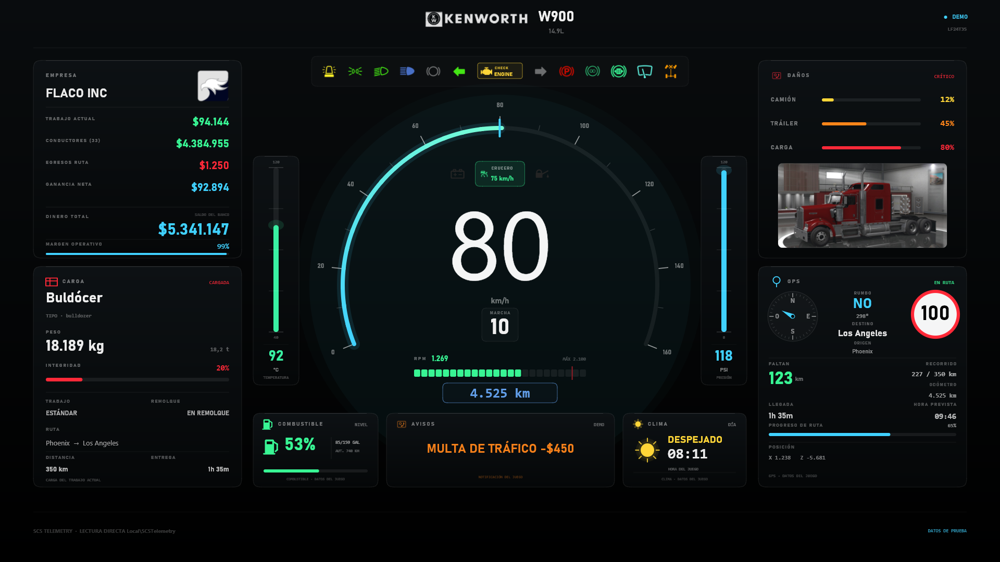

# ATS / ETS2 Native Telemetry App (FH6 v2.7)

<p align="center">
  
</p>

Aplicación de escritorio independiente para **Windows (x64)** que lee y muestra la telemetría en tiempo real de **American Truck Simulator (ATS)** y **Euro Truck Simulator 2 (ETS2)** con una interfaz gráfica avanzada basada en el panel **FH6 v2.7** a 60 FPS mediante **SkiaSharp**.

Última actualización: **31 de octubre de 2026**.

---

## Estado de trabajo (v2.7 cerrada)

- **Etapa 1 completada:** el panel **DAÑOS** muestra solo **CAMIÓN**, **TRÁILER** y **CARGA**.
  - El porcentaje queda alineado con su barra indicadora en la misma fila.
  - Se eliminaron **MOTOR**, **SISTEMA MÁS AFECTADO**, **PROMEDIO GENERAL** y la barra inferior.
  - La mitad inferior del panel queda libre.
- **Etapa 2 completada:** ese espacio muestra la **imagen del camión actual**, tal como lo presenta el concesionario.
  - La imagen se dibuja **centrada** en el área libre y con **margen interior de 8 px** en los cuatro lados.
  - Se escala de forma proporcional, se recorta con esquinas redondeadas y lleva un borde sutil.
  - El modelo se identifica con `TruckId`; si no hay coincidencia se prueba `TruckBrand` + `TruckName`, y se limpian sufijos de mods (`_gtm`, `_mod`, `_custom`).
- **Etapa 3 completada (v2.5):** catálogo completo de **45 modelos oficiales**.
  - **19 de ATS** y **26 de ETS2**, con un JPG de 1200 × 600 (calidad 90) por modelo en `Assets\TruckImages`.
  - Archivos nombrados con el `TruckId` normalizado (`vehicle.peterbilt.389` → `peterbilt_389.jpg`).
  - Mapeo validado sobre la DLL compilada: **45 probados, 0 fallos**.
  - Lista completa de modelos, fuentes y formato en `Assets\TruckImages\README.txt`.
  - Si el modelo activo no tiene imagen se muestra `IMAGEN DEL MODELO NO DISPONIBLE`; sin señal no se dibuja nada.
- **Etapa 4 completada (v2.7):** ajustes de interfaz sobre la v2.6.
  - El **testigo CHECK** solo se muestra con el motor encendido: en blanco si no hay avería y en amarillo cuando el juego lo marca. Sin motor desaparece con el resto de testigos.
  - El **chip de crucero** queda siempre visible: atenuado con `-- km/h` cuando está inactivo y en verde con la velocidad fijada cuando está conectado.
  - La **tarjeta de combustible** permanece encendida con el motor apagado y sigue mostrando nivel, galones, autonomía y barra.
  - La **imagen del camión** hace un fundido cruzado de **0,5 s** al cambiar de modelo, sin afectar la primera carga ni el fallback textual.
- **Demo:** usa `vehicle.kenworth.w900` / `TruckName = "W900"` para validar la imagen real.
- **EXE final:** `dist\ATS-Telemetry-Windows\ATSTelemetry.exe`
  - 178.721.534 bytes
  - SHA-256: `6AB88739EF3144C9D483C904FD617AFD5D1F52F969F7CFE79D2A5A4D715E07EF`
- **ZIP:** `dist\ATS-Telemetry-Windows.zip` regenerado con esta versión.
  - 75.179.454 bytes, 93 entradas
  - SHA-256: `87E7BC9B05E0AF0056F72CCD083F0598A1CFC4DEEF02E3223D8896044AED74E6`
  - Incluye los 45 JPG y su `README.txt` en `Assets\TruckImages`.
  - La carpeta portátil completa ocupa 183.111.611 bytes (174,6 MB).

---

## Características Principales

- **Independiente y Pasiva:** Aplicación nativa de Windows que se conecta de forma pasiva a la memoria compartida (`Local\SCSTelemetry`) del juego. No interfiere ni envía comandos al simulador.
- **Panel FH6 a 60 FPS:** Lienzo virtual escalable con velocímetro, odómetro, marcha, RPM, control de crucero y 13 testigos interactivos.
- **Logos Reales de Empresa:** Lee automáticamente el perfil activo (`profile.sii`) para mostrar el nombre y el logo real de empresa (`logo_0` a `logo_7`).
- **Clima Automático:** Detecta las condiciones climáticas (lluvia, tormenta, neblina, nublado) leyendo la humedad de la carretera desde la memoria del juego.
- **Daños con imagen del camión:** Panel reducido a camión, tráiler y carga, con porcentaje y barra en la misma fila. La mitad inferior muestra la imagen del modelo activo tal como aparece en el concesionario, centrada y con margen. Cobertura de los 45 modelos oficiales (19 ATS + 26 ETS2), con fundido cruzado de 0,5 s al cambiar de camión.
- **Testigos, crucero y combustible:** El CHECK se oculta sin motor, aparece en blanco con el motor encendido y se ilumina cuando el juego marca avería. El chip de crucero permanece visible siempre, atenuado si está inactivo. La tarjeta de combustible sigue encendida sin motor, mostrando nivel, galones, autonomía y barra.
- **Lectura de Finanzas:** Lee saldos de cuentas bancarias y registros de beneficios de conductores directamente desde el archivo `game.sii` del perfil.
- **Bandeja de Sistema (System Tray):** Control total de modo ventana, pantalla, clima manual y cierre seguro desde la bandeja de Windows.

---

## Requisitos del Sistema

- **Sistema Operativo:** Windows 10 / 11 (64 bits).
- **Runtime:** .NET 8.0 (incluido o autocontenido en el paquete portable).
- **Juegos compatibles:** American Truck Simulator (ATS) y/o Euro Truck Simulator 2 (ETS2).

---

## Guía de Instalación

### 1. Instalación del Plugin de Telemetría
Para que la aplicación reciba datos de los juegos, es necesario instalar el plugin de telemetría de RenCloud (`scs-telemetry.dll`) en cada simulador:
1. Ejecuta el instalador automático ubicado en la raíz:
   ```cmd
   install-plugin.bat
   ```
   *(El script detecta automáticamente las rutas de Steam para ATS y ETS2).*
2. **Reinicia el juego** para que cargue el plugin.

### 2. Ejecución de la Aplicación
Puedes ejecutar la aplicación ya compilada desde la carpeta `dist`:
- **Modo Demo (sin necesidad de abrir el juego):**
  ```cmd
  dist\ATS-Telemetry-Windows\ATSTelemetry.exe --demo --windowed
  ```
- **Modo Normal (con el juego abierto):**
  ```cmd
  dist\ATS-Telemetry-Windows\ATSTelemetry.exe
  ```

### 3. Compilación desde Código Fuente (Opcional)
Si deseas compilar la aplicación por tu cuenta:
```powershell
# Compilar y publicar la versión Release
.\build.ps1
```

---

## Versiones y Lanzamientos

### Versión actual: `v2.7` (Octubre 2026)
- **Corrección de testigos y crucero:**
  - El **CHECK** solo aparece con el motor encendido: en blanco si no hay avería y en amarillo cuando el juego lo marca. Sin motor se oculta con el resto de testigos.
  - El **chip de crucero** queda siempre visible: atenuado con `-- km/h` cuando está inactivo y en verde con la velocidad fijada cuando está conectado.
  - Se mantienen la tarjeta de combustible encendida sin motor y el fundido de 0,5 s al cambiar de camión.
- **Validación:** capturas aisladas del CHECK apagado, en blanco y en amarillo; chip de crucero inactivo y activo; demo final a 1920×1080 y 1280×720. La prueba en ATS/ETS2 real sigue pendiente.
- **Artefacto:** `dist\ATS-Telemetry-Windows\ATSTelemetry.exe`
  - 178.721.534 bytes
  - SHA-256: `6AB88739EF3144C9D483C904FD617AFD5D1F52F969F7CFE79D2A5A4D715E07EF`
- **Paquete portable:** `dist\ATS-Telemetry-Windows.zip` (x64, autocontenido).
  - 75.179.454 bytes, 93 entradas
  - SHA-256: `87E7BC9B05E0AF0056F72CCD083F0598A1CFC4DEEF02E3223D8896044AED74E6`
  - Incluye 45 JPG + `README.txt` en `Assets\TruckImages`.

### Versión estable anterior: `v2.6` (Octubre 2026)
- **Tres ajustes de interfaz:**
  - El **encuadre del testigo CHECK** quedaba siempre visible, incluso con el motor apagado.
  - La **tarjeta de combustible** permanecía encendida sin motor y conservaba nivel, galones, autonomía y barra.
  - La **imagen del camión** hacía un fundido cruzado de **0,5 s** al cambiar de modelo.
- **Validación:** demo a 1920×1080 y 1280×720; prueba aislada con motor apagado y medición del fundido. La prueba en ATS/ETS2 real quedó pendiente.
- **Artefacto:** `dist\ATS-Telemetry-Windows\ATSTelemetry.exe`
  - 178.721.534 bytes
  - SHA-256: `04576B1A29593FD0A60A2A2C5E2D5829E9940BDFD8D59853A897234B2FE8AAE2`
- **Paquete portable:** `dist\ATS-Telemetry-Windows.zip` (x64, autocontenido).
  - 75.179.327 bytes, 93 entradas
  - SHA-256: `934D110BCF354B2C5B4635E4A7BE4B6312681D4D3D489F51085D2680D6081908`

### Versión estable anterior: `v2.5` (Octubre 2026)
- **Cobertura completa de imágenes:** los 45 modelos oficiales instalados (19 ATS + 26 ETS2) tienen un JPG de 1200 × 600, calidad 90.
  - ATS usa capturas de concesionario de los sets `*_Stock`; ETS2 usa renders oficiales sobre fondo de estudio neutro.
  - DAF XF Electric usa una imagen real del blog de SCS Software; el Kenworth W900 conserva el recorte original de la v2.4.
  - Resolución por `TruckId` normalizado, variantes sin `_gtm`/`_mod`/`_custom` y respaldo `TruckBrand` + `TruckName`.
  - Fallback textual para modelos sin imagen; sin señal no se dibuja nada.
- **Validación:** demo a 1920×1080 y 1280×720; comprobación automática de los 45 mapeos (45 probados, 0 fallos). La prueba en ATS/ETS2 real queda pendiente.
- **Artefacto:** `dist\ATS-Telemetry-Windows\ATSTelemetry.exe`
  - 178.721.534 bytes
  - SHA-256: `3E597262ED889304151DDC6957197AF32FC2B5D3A3BF851D3A6DD9D0BC2F4EF0`
- **Paquete portable:** `dist\ATS-Telemetry-Windows.zip` (x64, autocontenido).
  - 75.178.911 bytes, 93 entradas
  - SHA-256: `B682B3FEBCC00AD95D2208EE47C9E4570D50AFABEF68D2865A6997772E99F25F`
  - Incluye 45 JPG + `README.txt` en `Assets\TruckImages`.

### Versión estable anterior: `v2.4` (Octubre 2026)
- **Mejoras:** panel de daños compacto (CAMIÓN, TRÁILER y CARGA) y primera imagen del camión actual, el Kenworth W900, centrada en el hueco libre con margen, escalado proporcional y fallback textual.

### Versión estable anterior: `v2.3` (Octubre 2026)
- **Mejoras:** Soporte completo de logos de empresa reales, renderizado optimizado a 60 FPS sin fugas GDI+, lectura de clima por humedad y selector de pantalla/modo ventana desde la bandeja del sistema.

---

## Atajos y Controles Útiles

- **Cambiar de pantalla / modo:** Usar el menú flotante de la bandeja de sistema, o argumentos `--screen=DISPLAY2`, `--windowed`.
- **Pantalla completa / Ventana:** Tecla `F11`.
- **Cerrar aplicación:** `Ctrl + Shift + Q` o clic derecho en la bandeja -> **Salir**.
- **Archivo de Preferencias:** `%LOCALAPPDATA%\ATSTelemetry\window.ini`.

---

## Estructura del Proyecto

```text
Windows Native Final/
  build.ps1 / build.bat          Script de compilación y publicación x64
  install-plugin.ps1 / .bat      Instalador del plugin scs-telemetry.dll
  run.bat / run-demo.bat         Lanzadores rápidos
  Assets/
    Indicators/                  Testigos e iconos indicadores (PNG)
    BrandLogos/                  Logos de marcas de camiones (DAF, Volvo, Scania, etc.)
    CompanyLogos/                Logos reales de empresa (logo_0..logo_7)
    TruckImages/                 45 JPG por modelo oficial + README.txt
    Plugins/scs-telemetry.dll    Plugin de telemetría SCS
  src/                           Código fuente en C# (.NET 8 + SkiaSharp + WinForms)
  dist/ATS-Telemetry-Windows/    Distribución portable compilada
  README.md                      Este documento
  GUIA-INTERFAZ.md               Guía técnica de la interfaz y coordenadas
  HISTORIAL.md                   Historial y bitácora de desarrollo
```

---

## Pendientes posteriores a v2.7

- [x] Añadir la imagen real del camión actual en el espacio libre del panel de daños.
- [x] Mantenerla centrada y con margen uniforme; usar fallback si el modelo no tiene imagen.
- [x] Cubrir los 45 modelos oficiales (19 ATS + 26 ETS2) con un JPG por modelo.
- [x] Validar el mapeo de los 45 `TruckId` contra los assets compilados.
- [x] Validar el resultado en demo a 1920 × 1080 y 1280 × 720.
- [x] Corregir el CHECK: oculto sin motor, blanco con motor y amarillo cuando el juego marca avería.
- [x] Mantener siempre visible el chip de crucero, atenuado cuando está inactivo.
- [x] Mantener encendida la tarjeta de combustible con el motor apagado.
- [x] Aplicar un fundido de 0,5 s al cambiar la imagen del camión.
- [x] Regenerar el ZIP y actualizar tamaños/SHA-256 al cerrar la versión.
- [ ] Validar en vivo varios modelos en ATS y ETS2, y el fallback con un modelo sin imagen o con mod.
- [ ] Valorar imágenes por configuración de pintura en una versión futura.

---

## Evolución y Capturas de Pantalla (Historial de Versiones)

Las capturas de pantalla guardadas en el repositorio documentan la evolución visual y técnica de la aplicación, cotejadas por su fecha y hora de creación:

1. **`Captura de pantalla 2026-10-26 190340.png`** *(26 Oct 2026 - 19:03)* -> **v2.0-alpha**: Estructura base inicial del lienzo SkiaSharp y pruebas de velocímetro.
2. **`Captura de pantalla 2026-10-26 204041.png`** *(26 Oct 2026 - 20:40)* -> **v2.0**: Incorporación de clúster de RPM, marcha y primeros testigos.
3. **`Captura de pantalla 2026-10-26 225454.png`** *(26 Oct 2026 - 22:54)* -> **v2.1**: Implementación de la cabecera de empresa y logotipos de marca.
4. **`Captura de pantalla 2026-10-27 234636.png`** *(27 Oct 2026 - 23:46)* -> **v2.2**: Adición de paneles de GPS, daños, clima y franja inferior de estado.
5. **`Captura de pantalla 2026-10-28 225007.png`** *(28 Oct 2026 - 22:50)* -> **v2.3 (Estable)**: Versión final con soporte de logos reales de empresa (`logo_N.png`), optimización a 60 FPS y lectura pasiva MMF.
6. **`Captura de pantalla 2026-10-28 233409.png`** *(28 Oct 2026 - 23:34)* -> **v2.4 - Etapa 1**: Panel de daños reducido a camión, tráiler y carga; porcentaje junto a la barra y mitad inferior libre.
7. **`fh6-v24-etapa2-1920.png`** *(29 Oct 2026)* -> **v2.4 - Etapa 2 (1920 × 1080)**: Imagen del Kenworth W900 del concesionario centrada en el hueco libre del panel de daños, con margen y esquinas redondeadas.
8. **`fh6-v24-etapa2-1280.png`** *(29 Oct 2026)* -> **v2.4 - Etapa 2 (1280 × 720)**: La misma composición en modo ventana, verificando el escalado del lienzo virtual.
9. **`fh6-v25-1920.png`** *(30 Oct 2026)* -> **v2.5 (1920 × 1080)**: Catálogo completo de 45 modelos oficiales instalado; el W900 de la demo se sigue mostrando centrado en el panel DAÑOS.
10. **`fh6-v25-1280.png`** *(30 Oct 2026)* -> **v2.5 (1280 × 720)**: La misma composición en ventana, con el escalado del lienzo y la imagen del camión verificados.
11. **`fh6-v26-1920.png`** *(30 Oct 2026)* -> **v2.6 (1920 × 1080)**: Encuadre del CHECK siempre visible, tarjeta de combustible encendida sin motor y fundido de 0,5 s al cambiar de camión.
12. **`fh6-v26-1280.png`** *(30 Oct 2026)* -> **v2.6 (1280 × 720)**: La misma composición en ventana, con los tres ajustes verificados en el escalado del lienzo.
13. **`fh6-v27-1920.png`** *(31 Oct 2026)* -> **v2.7 (1920 × 1080)**: CHECK normal, chip de crucero siempre visible, combustible sin motor y fundido de 0,5 s al cambiar de camión.
14. **`fh6-v27-1280.png`** *(31 Oct 2026)* -> **v2.7 (1280 × 720)**: La misma composición en ventana, con el escalado del lienzo verificado.

---

## Licencia y Créditos
- Desarrollado por **HS-Gaming**.
- Telemetría basada en `scs-telemetry.dll` de RenCloud.
- Interfaz gráfica inspirada en el estándar FH6.
